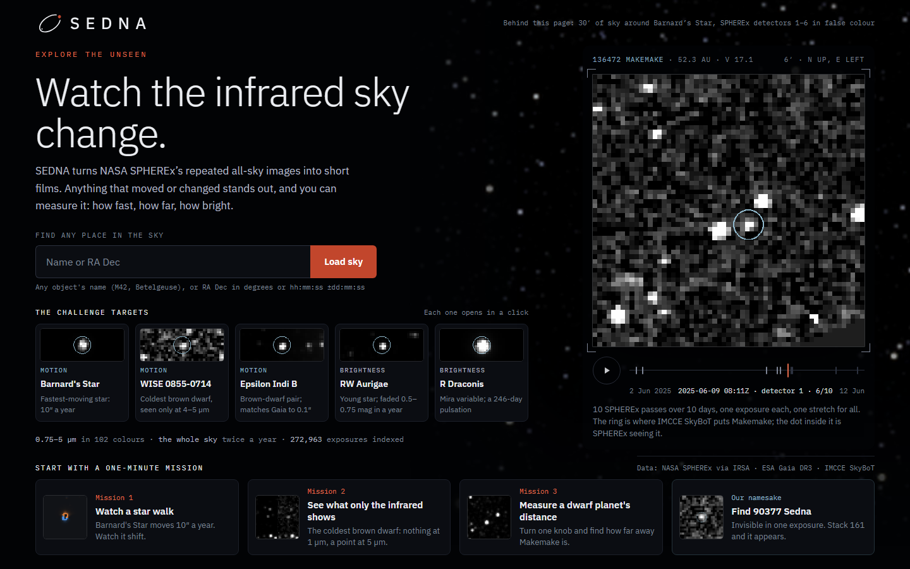
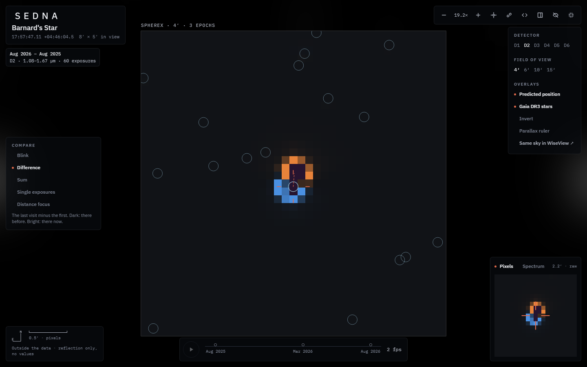
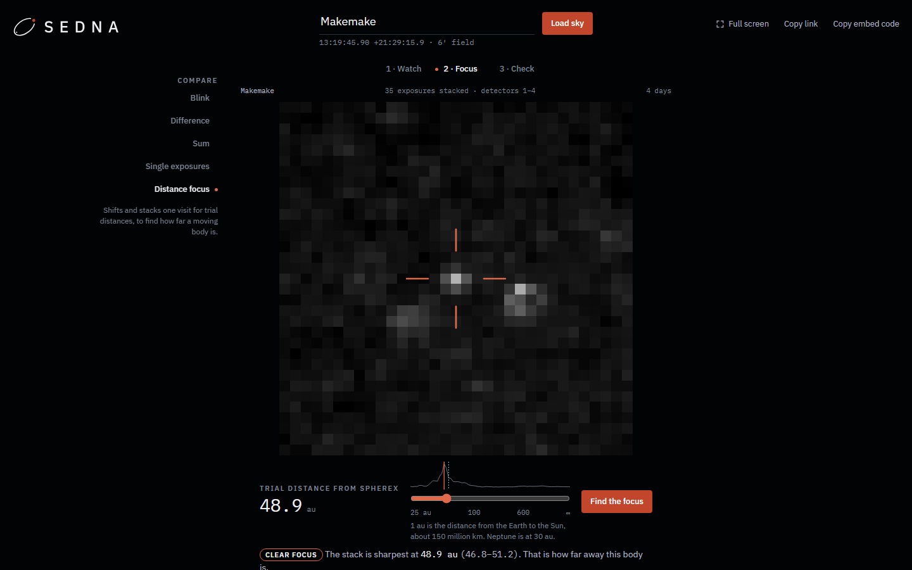
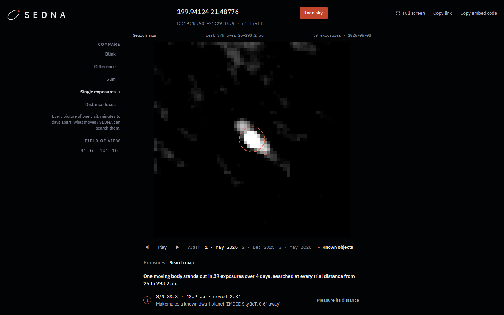

<p align="center">
  <picture>
    <source media="(prefers-color-scheme: dark)" srcset="docs/brand/logos/svg/sedna-horizontal-tagline-on-dark.svg">
    <source media="(prefers-color-scheme: light)" srcset="docs/brand/logos/svg/sedna-horizontal-tagline-on-light.svg">
    
  </picture>
</p>

<p align="center"><sub>Logo made with AI assistance, from the team's own style guide, sketches, colours and typography.</sub></p>

<p align="center"><strong>Watch the infrared sky change, and find what moves in it.</strong></p>

<p align="center">
  <a href="https://sednaspace.earth"><strong>Open SEDNA</strong></a> ·
  <a href="docs/video/sedna-demo-30s.mp4">Watch the 30-second demo</a> ·
  <a href="#try-it-in-two-minutes">Try it</a> ·
  <a href="#what-we-checked-on-real-data">Results</a> ·
  <a href="#and-planet-x">Planet X</a> ·
  <a href="#run-it-yourself">Run it yourself</a>
</p>

SEDNA is a free web tool that turns NASA SPHEREx's repeated infrared images of the whole sky into short films of any patch of sky. Anything that moved or changed stands out, and SEDNA helps measure it: how fast, how far, how bright. Nothing to install: it runs in the browser, on real NASA data, at **https://sednaspace.earth**.

Built by team Deneb for the NASA Space Apps Challenge 2026, challenge *Planet X and SPHEREx*.



## Try it in two minutes

| Click | What you will see |
| --- | --- |
| [**Watch a star walk**](https://sednaspace.earth/?mission=walk) | A one-minute guided mission: Barnard's Star moves between SPHEREx visits, while the stars around it stay put. |
| [**Search a region for moving worlds**](https://sednaspace.earth/?ra=199.94124&dec=21.48776&fov=6&band=1&mode=film), then press *Search this visit for moving bodies* | SEDNA searches the whole field on its own and finds the dwarf planet Makemake, with its distance. |
| [**Measure a distance with one knob**](https://sednaspace.earth/?ra=199.94124&dec=21.48776&fov=6&band=2&mode=focus&target=makemake), then open *2 · Focus* and press *Find the focus* | Makemake snaps into a sharp point at 48.9 au. *3 · Check* compares it with JPL Horizons: 52.4 au. |
| [**Find 90377 Sedna**](https://sednaspace.earth/?ra=60.70000&dec=8.60000&fov=6&band=2&mode=follow&target=sedna) | The world this tool is named after: invisible in any single exposure, it appears when 161 are stacked along its orbit. |
| **Type anything** on the start page | A name ("Orion Nebula", "Betelgeuse", "M42") or coordinates ("83.82 -5.39"). |

Press **F** for full screen. Every view is a link you can share.

## How it works, in three ideas

<table>
  <tr>
    <td width="33%" valign="top"></td>
    <td width="33%" valign="top"></td>
    <td width="33%" valign="top"></td>
  </tr>
  <tr>
    <td valign="top"><strong>1. Blink.</strong> Every SPHEREx visit of a patch of sky, aligned and shown in turn. Known stars (ESA Gaia DR3) and known asteroids (IMCCE SkyBoT) are marked, so a real change can be told from a known source.</td>
    <td valign="top"><strong>2. Focus by distance.</strong> A distant world jumps out of the frame between visits, but within one visit its motion depends almost only on its distance. SEDNA shifts and stacks the single exposures for each trial distance: at the right one, the body becomes a sharp point.</td>
    <td valign="top"><strong>3. Search a region.</strong> The same idea for a whole field at once, with no starting point. The search map lights up where a moving body stands out, and the same search on negated images tells how strong noise alone gets there.</td>
  </tr>
</table>

## What we checked on real data

| Claim | Result | Where |
| --- | --- | --- |
| The distance focus measures distances | Makemake 48.9 au (JPL Horizons: 52.4), Haumea 48.9 (49.4), Pluto 34.2 (35.5) | [decision tests](docs/decision-tests.md#the-distance-focus-as-the-product-runs-it) |
| The region search finds bodies without being told where | Makemake and Haumea in each of their three visits, Pluto and Eris once each: 8 of 11 visits, distances within 10 % of JPL Horizons | [decision tests](docs/decision-tests.md#the-search-as-the-product-runs-it) |
| …and does not invent them | No candidate in 40 searches of fields with no known body: the five challenge fields and 30 random fields | [probes/p19](probes/p19_search_checks.json) |
| The next visit can be predicted | Makemake found again 208 days later, 2.5″ from JPL Horizons, though it had moved 2.8° | [decision tests](docs/decision-tests.md#next-visit-check) |
| SPHEREx sees Sedna | S/N 9.8 from 161 exposures stacked along its orbit; none of 200 control tracks comes close | [decision tests](docs/decision-tests.md#90377-sedna-the-namesake) |
| The challenge targets behave as expected | Epsilon Indi B's motion within 0.07″ of Gaia DR3; WISE 0855 shows only at 4.4–5 µm; RW Aurigae faded 0.5–0.75 mag in a year; R Draconis's period 235 days (AAVSO: 246) | [target matrix](docs/target-matrix.md) |

**Limits, as the tool states them:** the model assumes a circular orbit in the ecliptic, so an eccentric orbit (Pluto) can be up to 40 % off; Eris-faint bodies (V = 18.6) are found only sometimes; Sedna-faint ones need their orbit; the region search covers fields up to 10′.

## And Planet X?

The latest estimate puts Planet Nine at a perihelion of about 300 au and a semi-major axis of about 380 au (Brown & Batygin 2021). SPHEREx photographs the whole sky every six months, so such a planet is in its images. SEDNA shows, on real data, what finding it takes:

- **Between visits it jumps.** Six months apart, a body at 300 au moves 25′ and one at 500 au moves 15′, several fields of view, so a blink of fixed coordinates cannot catch it. The parallax ruler shows this on any field.
- **Within a visit it barely moves:** 3–6 pixels in a week at 300 au. The region search reaches about 300 to 500 au, depending on how long the visit lasts.
- **It is faint.** Sedna (V = 20.8, 83 au) needs 161 exposures stacked along its known orbit to appear, and a distant planet seen by reflected sunlight is expected to be fainter still.

So the path is to link visits months apart with the same distance model, as the next-visit check already does for Makemake (found again 208 days later, 2.8° away), and to stack more data as SPHEREx keeps observing. SEDNA states this limit instead of promising a discovery.

## Everything it does

<details>
<summary>All features</summary>

- **Start page.** Fits one screen on laptops and phones: a real 30′ SPHEREx field drifting behind, Makemake crossing a field in ten single exposures, the search box, the five challenge targets and three missions. The brand intro plays once a session and can be skipped; nothing moves for visitors who ask for reduced motion.
- **Any position or name.** Coordinates, or any object's name as people write it: CDS Sesame finds it in SIMBAD, NED or VizieR, and fast stars are moved by their proper motion to SPHEREx's dates. SEDNA keeps its own index of every SPHEREx exposure (272,963 detector-1 frames, April 2025 to October 2026), so a lookup takes about 40 ms and a new 6′ field (about 400 exposures) is read in about 10 seconds.
- **Compare.** Blink, difference (later minus earlier) and sum; six detectors from 0.75 to 5 µm; fields of view from 4 to 15 arcmin; one brightness stretch for all dates.
- **Full screen.** A sky map you drag and zoom, with every control as a small widget at the edges and the panels in a drawer beside the sky.
- **Known or new?** Click a star: Gaia DR3 says whether it is known, and SIMBAD what it is. For every field, IMCCE SkyBoT lists the known asteroids, comets and dwarf planets that crossed it, and SEDNA opens the single exposures at that moment with the body ringed.
- **Brightness and spectrum.** Click a star to measure it in every exposure: its brightness over time per detector and its 0.75–5 µm spectrum on a chosen date, with each exposure's wavelength from the pipeline's own map. Saturated stars are measured in their wings. Values download as CSV.
- **Single exposures.** Every exposure of a visit in time order. Pause, click a point, and measure its distance.
- **Region search.** *Search this visit for moving bodies*: the stars are removed, every exposure is shifted for each trial distance and stacked, and the search map shows where something stands out. Each candidate gets a distance, SkyBoT's name if it is known, and one click to the distance focus.
- **Distance focus.** Three steps: watch the point walk, turn the knob until it snaps into focus, check the distance against JPL Horizons.
- **Next visit.** From the focus distance, SEDNA predicts where the body will be at SPHEREx's next visit, months later and degrees away, and searches that region.
- **Find Sedna.** 90377 Sedna stacked along its JPL Horizons orbit, visit by visit and all together, with control tracks.
- **Parallax ruler.** How far a body at 50 to 500 au, or a star at 2 pc, would move between two visits: why a blink of fixed coordinates cannot catch a distant world.
- **Missions.** Three one-minute guided missions (`?mission=walk`, `?mission=infrared`, `?mission=distance`) that advance only when the person has done each step.
- **Share and embed.** The URL reproduces the view; *Copy embed code* gives an iframe that fits 400 × 300; a link opens the same sky in WiseView.
- **Works offline.** If the data service does not answer, the site runs on prepared cases recorded from it, and says so.

</details>

## Run it yourself

You need Python 3.12+ and Node 22+.

```sh
# 1. the data service (reads SPHEREx straight from NASA's public bucket on AWS)
python -m venv .venv
.venv/Scripts/pip install -r service/requirements.txt     # macOS/Linux: .venv/bin/pip
cd service
../.venv/Scripts/python -m uvicorn sedna.api:app --port 8000

# 2. the web app, in another terminal
cd web
npm install
npm run dev                                                # http://127.0.0.1:5173
```

No data service? `npm run dev:demo` runs the whole site on the prepared cases in `web/public/demo`.

Tests: `npm test` in `web/`, and `../.venv/Scripts/python -m pytest` in `service/`. [docs/deploy.md](docs/deploy.md) explains the published setup (site on Vercel, data service on AWS Lambda) and the scripts that check it.

<details>
<summary>More: prepared cases, start page images, the sky index</summary>

- **Prepared cases.** With the data service and `npm run dev` running, `node scripts/bake-search.mjs` adds the region-search case to `web/public/demo`, and `node scripts/check-demo.mjs [app url]` checks every prepared flow with the service stopped.
- **Start page images.** Rendered from SPHEREx data with the app's own stretch: run the data service, then `.venv/Scripts/python web/scripts/render-landing.py` from the repository root.
- **Demo video.** `web/scripts/make-narration.py` makes the narration and `web/scripts/record-demo.mjs` records the published site scene by scene.
- **The sky index** ships in `data/index/compact.npz`. To rebuild it from the bucket:

```sh
cd service
../.venv/Scripts/python -m sedna.archive.build_index dr1 2025W00 2026W99 --detectors 1
../.venv/Scripts/python -m sedna.archive.build_index qr3 2026W00 2026W99 --detectors 1
../.venv/Scripts/python -c "from sedna.archive.skyindex import SkyIndex; SkyIndex.build_compact()"
```

</details>

## What is where

| Folder | What it holds |
| --- | --- |
| [`service/`](service/) | The data service in Python (FastAPI, astropy): reading the SPHEREx bucket, the sky index, the science (alignment, stacks, distance focus, region search, brightness) |
| [`web/`](web/) | The web app (React, Vite, TypeScript), its prepared cases and the scripts that check and record it |
| [`probes/`](probes/) | The scripts behind every result in `docs/`, with their outputs |
| [`docs/`](docs/) | [Decision tests](docs/decision-tests.md), [target matrix](docs/target-matrix.md), [references](docs/references.md), [deployment](docs/deploy.md), the [project page text](docs/submission.md), the [brand identity](docs/brand/README.md) and the [demo video](docs/video/) |
| [`deploy/aws/`](deploy/aws/) | The container and script that publish the data service on AWS Lambda |

## Data and credits

- **NASA SPHEREx** Level-2 spectral images, Data Release 1 ([10.26131/IRSA678](https://doi.org/10.26131/IRSA678)) and Quick Release 3 ([10.26131/IRSA662](https://doi.org/10.26131/IRSA662)), from the NASA/IPAC Infrared Science Archive, read from the AWS Open Data bucket `nasa-irsa-spherex`. This work makes use of data products from the Spectro-Photometer for the History of the Universe, Epoch of Reionization and Ices Explorer (SPHEREx), which is a joint project of the Jet Propulsion Laboratory and the California Institute of Technology, and is funded by the National Aeronautics and Space Administration.
- **ESA Gaia DR3**, through the ESA Gaia archive. This work has made use of data from the European Space Agency (ESA) mission Gaia (https://www.cosmos.esa.int/gaia), processed by the Gaia Data Processing and Analysis Consortium (DPAC, https://www.cosmos.esa.int/web/gaia/dpac/consortium).
- **JPL Horizons** and **IMCCE SkyBoT** for Solar System bodies; **CDS** SIMBAD, VizieR and Sesame; **AAVSO VSX**; **WiseView** as the model for the viewer.

Every reference, with links and DOIs, including the published methods behind the distance focus and the region search: **[docs/references.md](docs/references.md)**.

## Use of AI

Built with AI coding assistants (Claude Code and Codex) under the team's direction. The idea of focusing the sky by distance is the team's; the AI helped check that it was feasible, and wrote much of the code with the team. The team designed the visual identity (name, historical research, references, sketches, style guide, colours and typography, composed in Affinity), and the AI generated the final logo and animations from it; they carry a visible AI label where they are shown. The demo video's narration voice is synthetic. Details: [AI_USAGE.md](AI_USAGE.md).

## License

Code: MIT ([LICENSE](LICENSE)). Data products keep their own terms.
